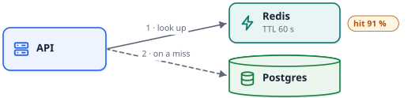

# Caching order reads

A read of one order is answered from Redis when it can be, and from Postgres when it cannot. This
handout says how, what it costs, and what to watch.

## The path



1. The API looks the order up in Redis.
2. On a miss it reads Postgres, and writes the row back to Redis for 60 seconds.
3. The next read of the same order is a hit.

## What it costs

| Read | p50 | p99 |
|---|---:|---:|
| Hit | 9 ms | 13 ms |
| Miss | 41 ms | 48 ms |

A miss is a slower read, not an error. What matters is the **hit rate**: each point lost moves
about 6 000 reads a day onto Postgres.

## The code

```python
def get_order(order_id: int) -> Order:
    cached = redis.get(f"order:{order_id}")
    if cached is not None:                      # a hit: 13 ms at p99
        return Order.parse(cached)
    order = db.fetch_order(order_id)            # a miss: Postgres
    redis.set(f"order:{order_id}", order.dump(), ex=60)
    return order
```

## Read more

The design note, with the sequence of a miss and the week's numbers, is one scan away:


